<div align="center">

<a href="docs/T_SAFE_presentation.pdf">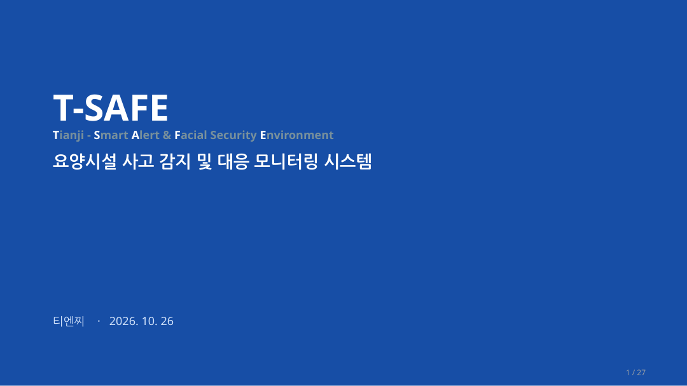</a>

# T-SAFE

**Tianji — Smart Alert & Facial Security Environment**

**요양시설 사고 감지 및 대응 모니터링 시스템**

얼굴 인식 출입 관리 · CCTV 쓰러짐 감지 · 입소자 및 직원 관리

[프로젝트 소개](#01-프로젝트-소개) · [설계](#02-시스템-설계) · [구현](#03-주요-기능-및-구현) · [시연 영상](#04-시연-영상) · [실행 방법](#05-실행-방법) · [발표자료](#07-발표자료)

</div>

---

## 00. 팀 소개

**팀명: 티엔찌 (Tianji)**  
T-SAFE는 요양시설의 출입 통제와 쓰러짐 상황 대응을 돕는 팀 프로젝트입니다.

### 사용 기술

| 구분 | 기술 |
|:---|:---|
| 개발 언어 | `Python` · `Arduino C/C++` · `SQL` · `Bash` |
| AI / 영상처리 | `Ultralytics YOLO` · `InsightFace` · `OpenCV` · `PyTorch` |
| 서버 / 데이터 | `FastAPI` · `PostgreSQL` · `pgvector` |
| 통신 / 장치 | UDP · TCP · HTTP · USB Serial · Arduino · 카메라 · 서보모터 |
| 협업 | `GitHub` · `Jira` · `Confluence` |

> 언어는 저장소에 확인된 Python·Arduino 스케치(C/C++)·SQL·Bash를 기준으로 적었습니다. GUI 화면의 스타일 리소스는 구현에 따라 별도로 포함될 수 있습니다.

> **시각자료 출처:** 이 README의 프로젝트 이미지, GIF, 영상 및 설계 도표는 팀에서 제공한 **T_SAFE.pptx**, **Sequence_diagram.pptx**, **얼굴인식 출입 시연 영상**에서만 추출했습니다. 비교용 RAIL 저장소의 사진·그래픽이나 임의 생성 이미지는 사용하지 않았습니다. 기술 스택은 실제 T-SAFE GitHub 소스와 제공 문서에 근거합니다.

## 01. 프로젝트 소개

### 배경과 목표

요양시설에서는 직원이 모든 공간을 실시간으로 확인하기 어렵고, 입소자의 쓰러짐·무단 외출·외부인 출입에 신속히 대응할 필요가 있습니다. T-SAFE는 **출입 권한 판단, 영상 모니터링, 이상 상황 알림, 인원 정보 관리**를 하나의 시스템으로 연결합니다.

| 출입 관리 | 모니터링·쓰러짐 감지 | 인원 정보 관리 |
|:---:|:---:|:---:|
| 얼굴 추적·신원 확인·문 제어 | CCTV 분석·FALL 알림·관리자 확인 | 등록·조회·수정·삭제 |

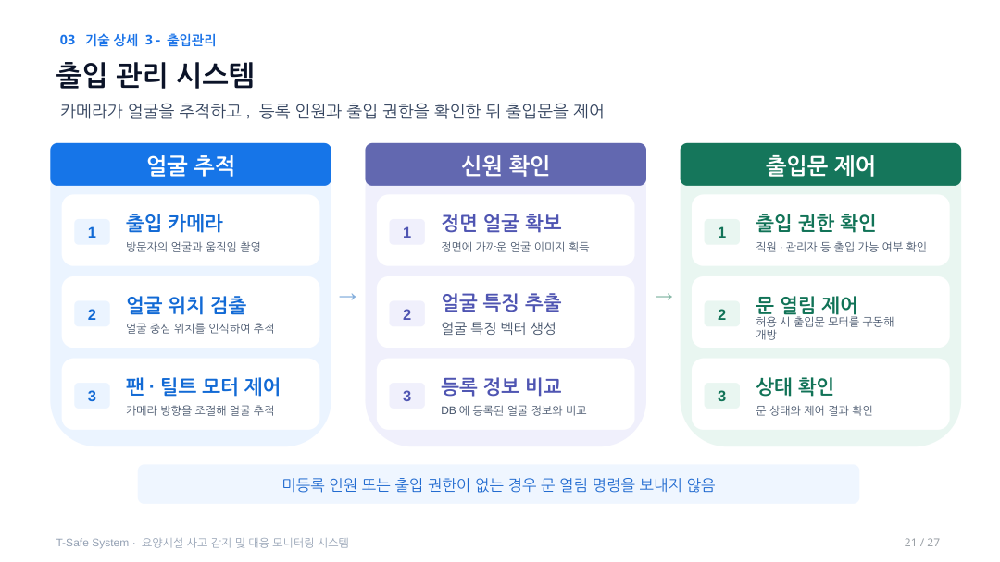

### 사용 시나리오

1. **출입 상황:** 카메라가 얼굴을 추적하고 등록 인물 및 출입 권한을 확인한 후, 허용된 경우에만 문 열림 명령을 보냅니다.
2. **평상시:** 직원이 관리자 GUI에서 인원 정보, CCTV와 기록을 조회·관리합니다.
3. **쓰러짐 상황:** 자세·동작 분석 결과가 확정되면 이벤트와 알림을 기록하고 관리자가 확인 및 종료 처리합니다.

## 02. 시스템 설계

### 시스템 아키텍처

*시각자료: T-SAFE 발표자료의 System Architecture 슬라이드*

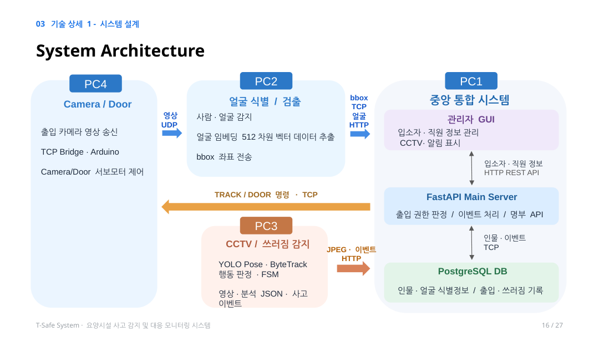

| 구성 | 담당 기능 | 구현 기술 |
|:---|:---|:---|
| 출입 카메라·도어 키트 | 영상 송신, 팬·틸트 및 출입문 모터 구동 | OpenCV, UDP, TCP Bridge, Arduino Serial |
| 얼굴 검출·식별 | 얼굴/몸 검출, 추적 좌표, 512차원 얼굴 벡터 | YOLO11n, InsightFace `buffalo_l` |
| CCTV 분석 장치 | 사람 추적, 관절 추출, 쓰러짐 후보 판정 | YOLO Pose, ByteTrack, LSTM |
| 중앙 서버 | 모듈 연결, 신원·권한 확인, 이벤트 처리 | Python, FastAPI |
| 데이터베이스 | 등록 인물, 특징 벡터, 출입·쓰러짐 기록 | PostgreSQL, pgvector |
| 관리자 GUI | 인원 관리, 출입·문 상태, 영상·알림 표시 | 저장소 내 GUI 및 서버 API |

### 데이터베이스

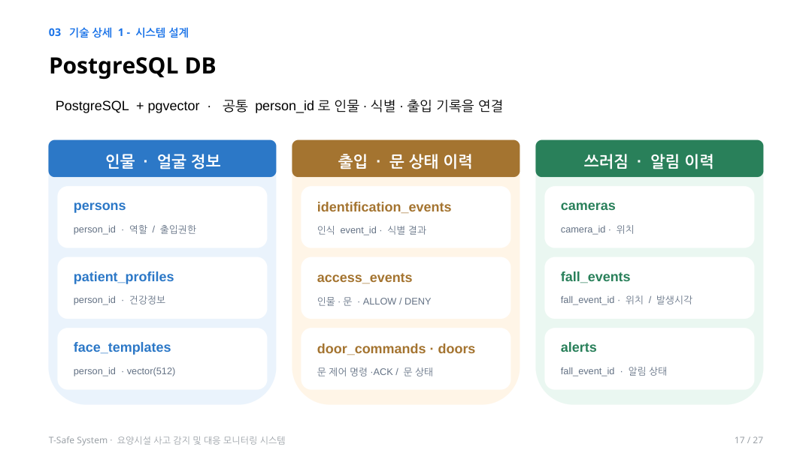

`persons`와 `patient_profiles`에 인물·건강 정보를, `face_templates`에 얼굴 임베딩을 관리합니다. `access_events`·`door_commands`는 출입 기록을, `fall_events`·`alerts`는 사고 및 확인·종료 이력을 관리합니다. 얼굴 임베딩의 유사도 검색에는 `pgvector`를 사용합니다.

### 중앙 서버

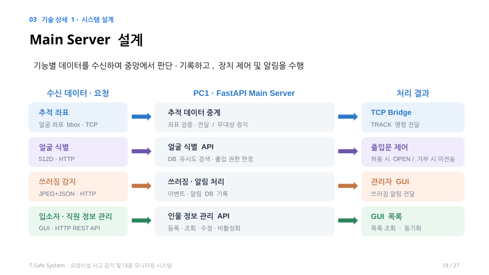

중앙 서버는 추적 좌표 중계, 얼굴 특징 벡터 검색 및 권한 판정, 쓰러짐 이벤트 저장, 관리자 GUI 요청 처리를 연결합니다.

### 시퀀스 다이어그램

다음 도표는 팀이 제공한 `Sequence_diagram.pptx`를 기준으로 통신 명세에서 확인되는 HTTP·TCP·SQL을 표시하고, 확인할 수 없는 빈 괄호 및 빨간 예시 표시를 제거한 수정본입니다.

<details><summary><strong>인원 등록·수정·삭제</strong> — 클릭하여 펼치기</summary>

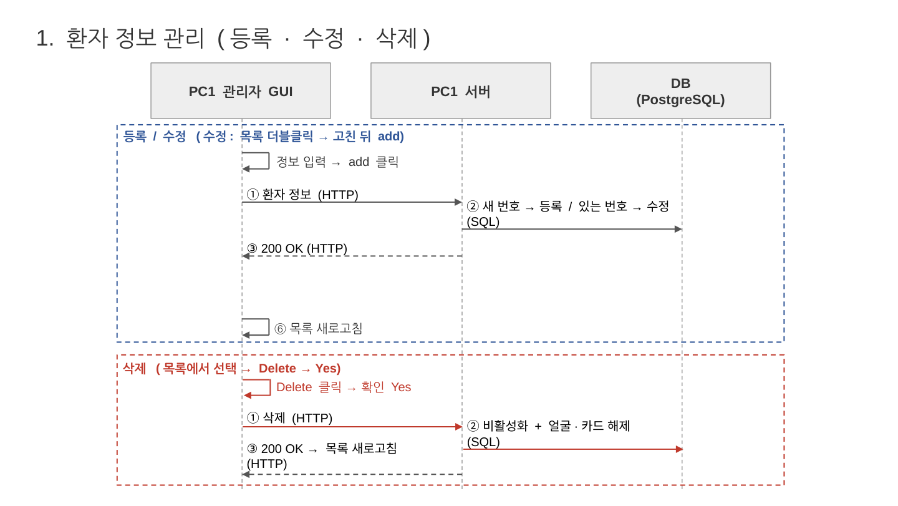

등록·수정·삭제 요청과 서버 DB 반영, 관리자 목록 갱신 과정입니다.

</details>

<details><summary><strong>얼굴 인식 기반 출입 제어</strong> — 클릭하여 펼치기</summary>

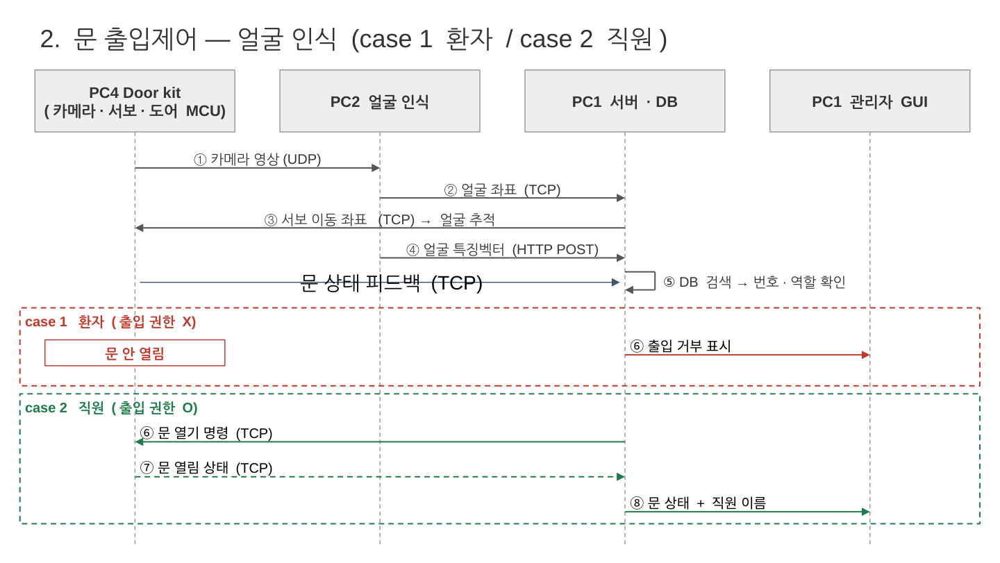

출입 카메라 → 얼굴 분석 → 중앙 서버의 신원 및 권한 판정 → 출입문 제어 순서입니다.

</details>

<details><summary><strong>쓰러짐 감지 및 알림 생성</strong> — 클릭하여 펼치기</summary>

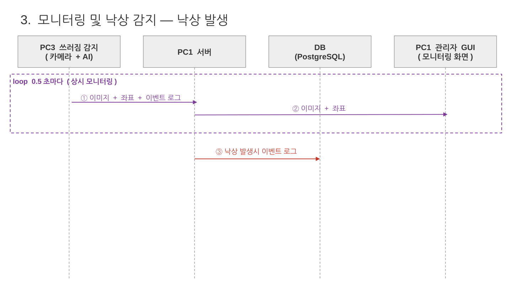

CCTV 영상·AI 분석 결과가 서버로 전달되고 확정 이벤트가 알림으로 기록됩니다.

</details>

<details><summary><strong>관리자 확인 및 알림 종료</strong> — 클릭하여 펼치기</summary>

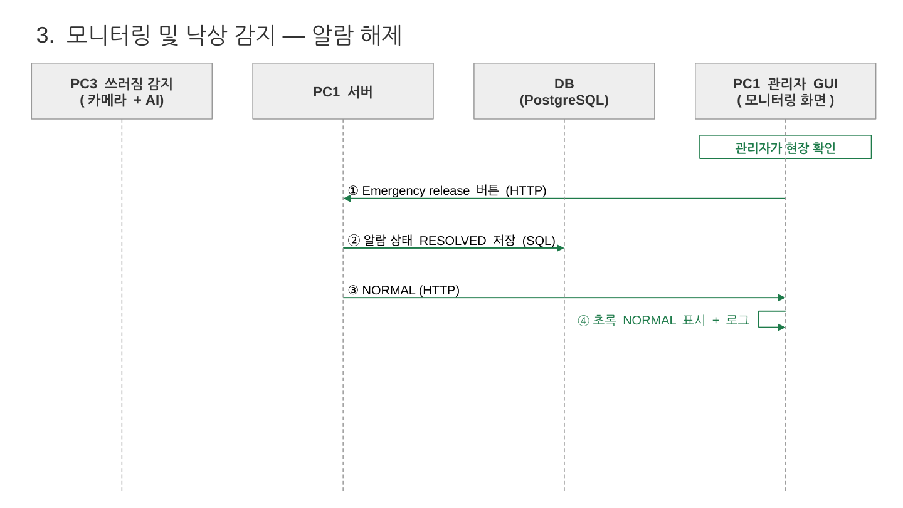

관리자 조치 후 알림 상태를 갱신하고 로그를 유지하는 흐름입니다.

</details>

## 03. 주요 기능 및 구현

### 얼굴 추적·인증·출입 제어


| 특징 벡터 생성 | 신원 확인 및 권한 판정 |
|:---:|:---:|
| 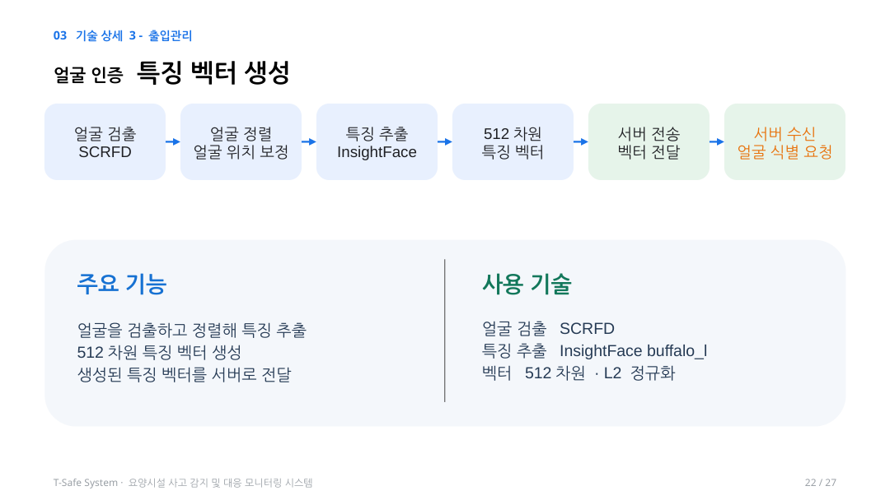 | 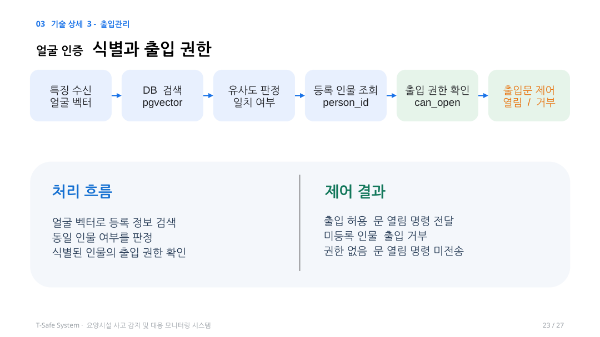 |

- 카메라 영상에서 사람과 얼굴을 검출하고 얼굴 위치를 따라 팬·틸트 방향을 조절합니다.
- SCRFD와 InsightFace를 이용해 얼굴을 정렬하고 512차원 특징 벡터를 생성합니다.
- DB에서 등록된 얼굴을 비교한 뒤 **얼굴 식별 여부와 출입 허용 여부를 별도로 판단**합니다.
- 미등록 인물 또는 출입 권한이 없는 경우 문 열림 명령을 보내지 않습니다.

**출입 기능 시연 GIF**

*원본: 사용자가 제공한 얼굴 인식·출입 시연 영상*

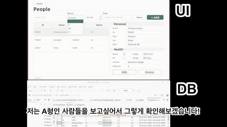

### 관리자 GUI — 인원 등록·수정·삭제

*화면: T-SAFE 발표자료에 포함된 People / Register 실제 GUI 캡처*

| 인원 목록 및 상세 정보 | 새 인원 등록 |
|:---:|:---:|
| 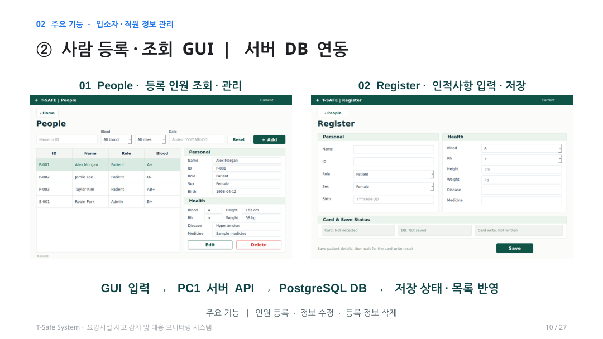 | 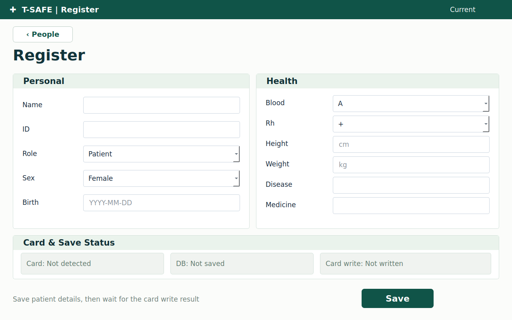 |

관리자는 인물의 기본정보와 건강정보를 등록·수정·조회·삭제할 수 있습니다. 등록·수정 결과는 중앙 서버의 DB에 반영합니다. 삭제 처리는 서버 구현 기준으로 비활성화 및 얼굴 템플릿 해제를 포함합니다.

### CCTV 쓰러짐 감지 및 대응

*화면: T-SAFE 발표자료에 포함된 CCTV GUI 캡처*

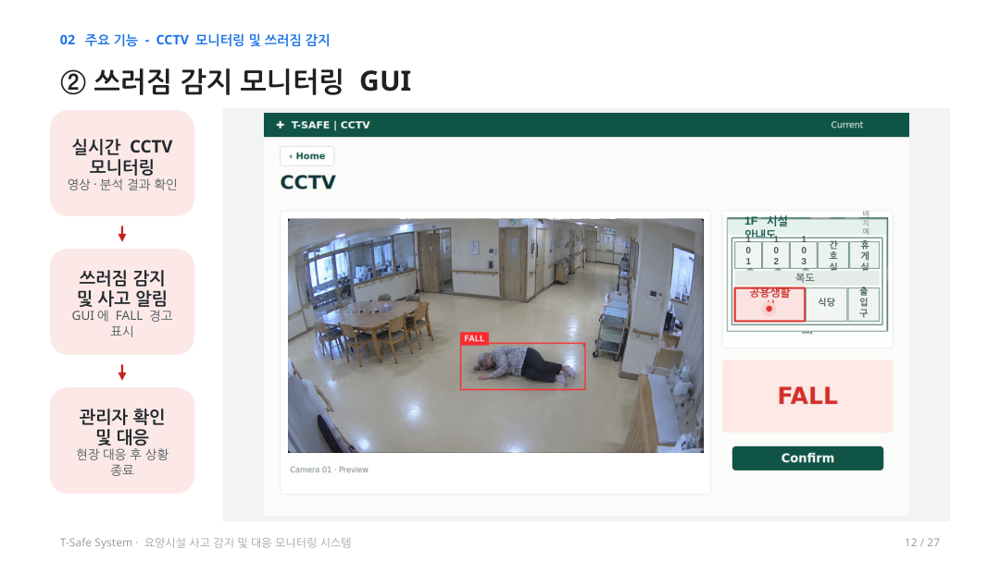

- 사람별 17개 관절 정보와 추적 ID를 기반으로 쓰러짐 후보를 분석합니다.
- 이벤트가 확정되면 중앙 서버에 전달하고, 관리자는 `FALL` 표시와 사고 발생 정보를 확인합니다.
- 관리자 확인·상황 종료 후 알림 상태는 변경되지만 기록은 유지됩니다.

> **버전 구분:** 발표자료 일부의 `PoseC3D / 48프레임`은 설계 설명입니다. 현재 GitHub `service/ai_service/fall_detection` README는 **YOLO26 Pose + ByteTrack + LSTM / 40프레임** 구현을 설명합니다. 실제 실행할 때는 해당 코드와 설정값을 우선 확인해야 합니다.

## 04. 시연 영상

<div align="center">

[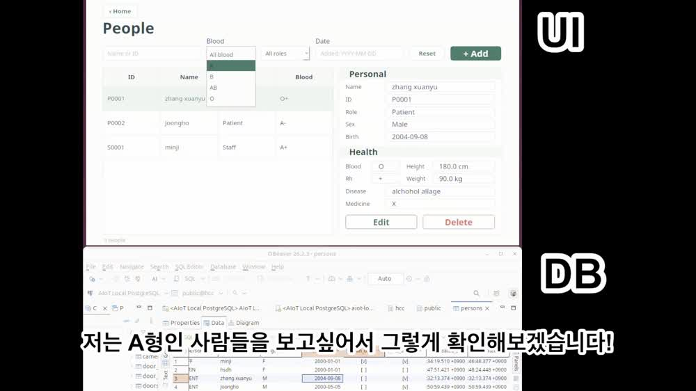](docs/T_SAFE_demo.mp4)

**[얼굴 인식 및 출입 관리 시연 영상 재생 (MP4)](docs/T_SAFE_demo.mp4)**

[](docs/T_SAFE_highlights.mp4)

**[T-SAFE 통합 시연 하이라이트 (MP4)](docs/T_SAFE_highlights.mp4)**

</div>

출입 제어 시연 영상과 추가 통합 시연 하이라이트 영상을 포함했습니다. 재생 링크는 영상 파일을 GitHub 저장소에 같이 업로드했을 때 동작합니다. 원본은 105초이며, README용 영상은 GitHub에서 공유하기 쉽도록 재인코딩했습니다.

## 05. 실행 방법

저장소에 실제 포함된 실행 파일을 기준으로 간단한 시작 방법을 정리했습니다. 각 장치의 IP 주소, 카메라 번호, GPU 모델 파일, DB 접속 정보는 환경에 맞게 설정해야 합니다.

### 중앙 서버와 PostgreSQL

```bash
git clone https://github.com/sesac-robotics/aiot_repo_1.git
cd aiot_repo_1/service/main_service
docker compose up -d --build
```

API 문서: `http://localhost:8101/docs` / 상태 점검: `http://localhost:8101/health`

### 출입 카메라 송신

```bash
# 저장소 루트에서 실행
bash device/door_face_camera/start.sh --pc2-ip <FACE_AI_PC_IP> --camera 0
```

### 얼굴 검출 및 특징 벡터 추출

```bash
# 저장소 루트에서 실행
bash service/ai_service/face_recongnition/start.sh --pc1-host <MAIN_SERVER_IP> --udp-port 8766
```

기본 실행에는 GPU/InsightFace 모델 파일 및 `.env` 설정이 필요할 수 있습니다. [얼굴 인식 세부 README](service/ai_service/face_recongnition/README.md)에서 모델·가상환경·통신 준비를 먼저 확인합니다.

### CCTV 쓰러짐 감지

```bash
cd service/ai_service/fall_detection
python3 run_fall_detection.py --source <VIDEO_PATH>
```

모델 가중치, 의존성 및 `config.py`의 전송 URL 설정은 [쓰러짐 감지 README](service/ai_service/fall_detection/README.md)를 참고하세요.

> 위 명령은 개별 모듈 실행 출발점입니다. 실제 하드웨어·GPU·카메라 설정 없이 전체 시스템이 즉시 실행되는 명령으로 해석하지 마세요.

### 저장소 구조

```text
aiot_repo_1/
├── device/
│   ├── cctv_tracking_servo/
│   ├── door_controller/
│   ├── door_face_camera/
│   └── image_sender/
├── service/
│   ├── ai_service/
│   │   ├── face_recongnition/
│   │   └── fall_detection/
│   └── main_service/
├── ui/
│   ├── gui/
│   └── hcc_gui/
├── test/
├── docs/                      # README와 함께 추가하는 자료
└── README.md
```

## 06. 구현 결과 및 개선 방향

| 구분 | 현재 자료에서 확인된 내용 | 보완 및 검증 |
|:---|:---|:---|
| 출입 관리 | 얼굴 검출·임베딩·서버·도어 명령 연계 구조 및 시연 영상 | 조명·거리·복수 인물 환경의 정확도 검증 |
| GUI/DB | 인원 등록·조회·수정·삭제 설계 및 화면 시연 | DB 동기화·중복 등록·화면 갱신 검증 |
| 쓰러짐 감지 | AI 분석과 GUI 알림 시연 자료 | 실제 요양시설 환경에서 정탐·오탐 측정 |
| 하드웨어 통신 | 펌웨어·통신 시험 기록 일부 | 모든 장치의 실물 연동·복구 시험 |

현재 프로젝트 결과는 **프로토타입 및 데모 기준**이며, 상용 시설 운영에 필요한 안전성·개인정보 보호·장기간 신뢰성을 보증하지 않습니다.

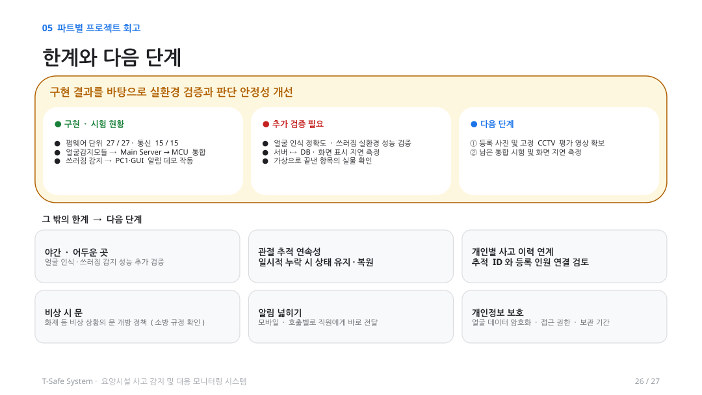

## 07. 발표자료

발표자료의 주요 내용을 아래에서 순서대로 확인할 수 있습니다. 원본 전체는 PDF 또는 PPTX로 열 수 있습니다.

<div align="center">

[**발표자료 PDF**](docs/T_SAFE_presentation.pdf) · [**발표자료 PPTX**](docs/T_SAFE_presentation.pptx) · [**시퀀스 다이어그램 PDF**](docs/Sequence_diagram.pdf) · [**편집 가능한 시퀀스 다이어그램 PPTX**](docs/Sequence_diagram_updated.pptx)

</div>

<details><summary><strong>발표자료 미리보기 — 클릭하여 펼치기</strong></summary>

| 프로젝트 소개 | 시스템 아키텍처 |
|:---:|:---:|
|  |  |

| 데이터베이스 | 중앙 서버 |
|:---:|:---:|
|  |  |

| 출입 제어 | 향후 개선 |
|:---:|:---:|
|  |  |

</details>

## 개발 문서

- [GitHub 소스 저장소](https://github.com/sesac-robotics/aiot_repo_1)
- [T-SAFE Confluence](https://sessac-tianji.atlassian.net/wiki/spaces/yo7gvXWgJeYC/overview?homepageId=557157)
- [System Requirements](https://sessac-tianji.atlassian.net/wiki/spaces/yo7gvXWgJeYC/pages/917507/System+Requirements)
- [System Architecture](https://sessac-tianji.atlassian.net/wiki/spaces/yo7gvXWgJeYC/pages/819211/System+Architecture)
- [T-SAFE Sequence Diagram](https://sessac-tianji.atlassian.net/wiki/spaces/yo7gvXWgJeYC/pages/7831674/T_SAFE+Sequence+Diagram)
- [Main Server 실행 및 API](service/main_service/README.md)
- [얼굴 인식 모듈 실행](service/ai_service/face_recongnition/README.md)
- [쓰러짐 감지 모듈 실행](service/ai_service/fall_detection/README.md)

---

<div align="center">

**T-SAFE | Tianji**  
요양시설 사고 감지 및 대응 모니터링 시스템

</div>


## 자료 출처 및 이미지 사용 기준

| README 자료 | 출처 |
|:---|:---|
| 프로젝트 표지, 시스템 아키텍처, DB, 중앙 서버, 얼굴 인증 흐름 | 팀 제공 `T_SAFE.pptx` |
| People·Register·Door Access·CCTV GUI | 팀 제공 `T_SAFE.pptx`에 삽입된 화면 |
| 인원 관리·얼굴 출입·쓰러짐·알림 종료 시퀀스 | 팀 제공 `Sequence_diagram.pptx` |
| 얼굴 인식 GIF, 영상 대표 이미지, MP4 | 팀 제공 `얼굴인식 출입(2).mp4` |
| 구현 방법·명령·모듈 구조 | [T-SAFE GitHub 저장소](https://github.com/sesac-robotics/aiot_repo_1) |
| 요구사항·설계 배경·문서 | [T-SAFE Confluence](https://sessac-tianji.atlassian.net/wiki/spaces/yo7gvXWgJeYC/overview?homepageId=557157) |

**외부 프로젝트의 이미지, 스톡 사진 및 생성형 예시 그림은 포함하지 않았습니다.** `docs/assets`와 `docs/diagrams`는 위 자료로 만든 결과물이며, 출처를 확인할 수 없는 추가 사진은 README에 사용하지 않습니다.
